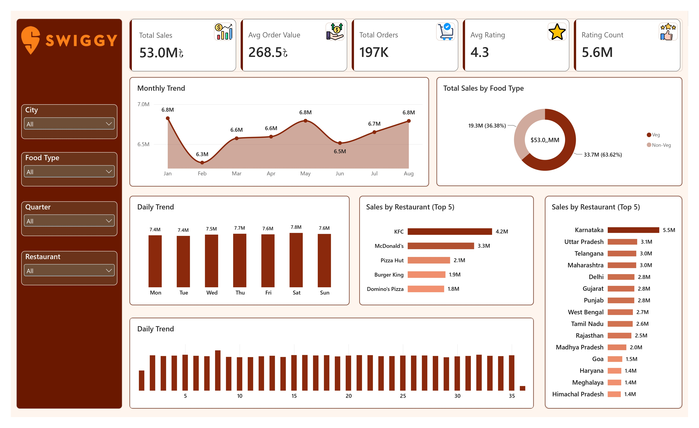
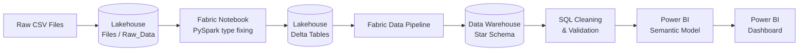
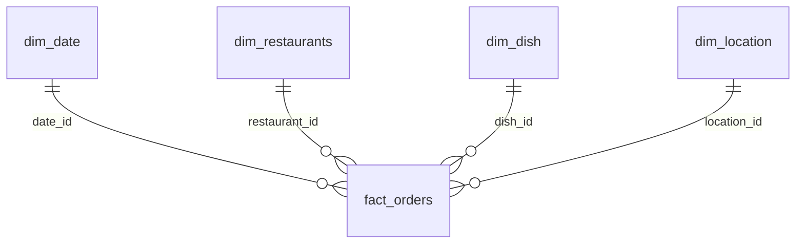

<div align="center">

# 🍔 Swiggy Data Analytics

### End-to-End Data Pipeline using Microsoft Fabric, SQL & Power BI





</div>

---

## 📑 Table of Contents

- [Project Overview](#-project-overview)
- [Business Scenario](#-business-scenario)
- [Objectives](#-objectives)
- [Tech Stack](#-tech-stack)
- [Architecture](#-architecture)
- [Data Model (Star Schema)](#-data-model-star-schema)
- [Data Cleaning & Validation](#-data-cleaning--validation)
- [Power BI Semantic Model & Measures](#-power-bi-semantic-model--measures)
- [Dashboard](#-dashboard)
- [Key Insights](#-key-insights)
- [Challenges & Learnings](#-challenges--learnings)
- [Repository Structure](#-repository-structure)
- [How to Reproduce](#-how-to-reproduce)
- [Future Enhancements](#-future-enhancements)
- [Author](#-author)

---

## 📌 Project Overview

This project demonstrates a complete, production-style analytics workflow built on **Microsoft Fabric**. Raw Swiggy food-delivery data is ingested into a **Lakehouse**, cleaned and validated with **SQL**, modeled into a **star schema** inside a **Data Warehouse**, exposed through a **Power BI Semantic Model**, and finally visualized in an interactive **Power BI dashboard**.

The full business requirement is available here: [`docs/Business_Requirement.docx`](docs/Business_Requirement.docx)

---

## 🏢 Business Scenario

Swiggy is one of India's largest online food delivery platforms, connecting customers, restaurants, and delivery partners across multiple cities. Every day, thousands of orders generate large volumes of operational data covering:

- Customers
- Restaurants
- Orders
- Delivery partners
- Payments and delivery performance

Swiggy wants to use this data to **analyze business performance, improve delivery efficiency, and understand customer behavior**. As the Data Analyst, the goal is to design an end-to-end solution that turns raw data into actionable business insights.

---

## 🎯 Objectives

- Store raw Swiggy datasets in a **Lakehouse**
- Clean and validate the data using **SQL**
- Model the data inside a **Data Warehouse** using a star schema
- Build a **Power BI Semantic Model** with relationships, measures, and KPIs
- Create interactive **Power BI dashboards**
- Publish the final report for business stakeholders

---

## 🧰 Tech Stack

| Layer | Technology |
| --- | --- |
| Data Storage (Raw) | Microsoft Fabric Lakehouse |
| Data Processing / Orchestration | Fabric Data Pipelines, Fabric Notebooks (PySpark) |
| Data Cleaning | SQL (T-SQL) |
| Data Modeling | Microsoft Fabric Data Warehouse |
| Semantic Layer | Power BI Semantic Model |
| Visualization | Power BI Reports |
| Version Control | Git & GitHub |

---

## 🏗 Architecture



**Workspace:** `Swiggy Analytics Project`, containing the Lakehouse, Data Warehouse, Data Pipelines, Semantic Model, and Power BI Report.

### Lakehouse folder layout

```
Files
└── Raw_Data
    ├── customers.csv
    ├── restaurants.csv
    ├── orders.csv
    ├── delivery_partners.csv
    └── deliveries.csv
```

---

## ⭐ Data Model (Star Schema)

The Data Warehouse follows a **star schema** to support fast, intuitive analytics.

| Type | Table | Description |
| --- | --- | --- |
| Dimension | `dim_date` | Calendar attributes (date, month, quarter, day of week) |
| Dimension | `dim_restaurants` | Restaurant details |
| Dimension | `dim_dish` | Dish and food type (Veg / Non-Veg) details |
| Dimension | `dim_location` | City / state level location details |
| Fact | `fact_orders` | Order-level transactions, sales, and ratings |



> The key column names above are illustrative. Adjust them to match your actual warehouse schema.

---

## 🧹 Data Cleaning & Validation

Data quality checks were performed with SQL before modeling:

- Removing duplicate records
- Handling missing values
- Correcting invalid date formats (for example `dd-MM-yy` strings converted to `DATE`)
- Validating order amounts
- Standardizing city names
- Checking referential integrity between tables

**Example validation checks**

| Check | Purpose |
| --- | --- |
| Orders without customers | Detect orphan records |
| Orders without restaurants | Detect orphan records |
| Negative order amounts | Detect invalid transactions |
| Delivery time earlier than pickup time | Detect logical errors |

**Sample: duplicate check**

```sql
SELECT date_id, COUNT(*) AS cnt
FROM Swiggy_project.Dim_Date
GROUP BY date_id
HAVING COUNT(*) > 1;
```

All SQL scripts are available in the [`sql/`](sql/) folder.

---

## 🧮 Power BI Semantic Model & Measures

A semantic model was built on top of the Data Warehouse, with defined table relationships, measures, and KPIs.

| Measure | Description |
| --- | --- |
| Total Sales / Total Revenue | Sum of order value |
| Total Orders | Count of orders |
| Average Order Value | Total sales divided by total orders |
| Average Rating | Mean customer rating |
| Rating Count | Total number of ratings |
| Average Delivery Time | Mean delivery duration |
| Orders per Restaurant | Orders divided by distinct restaurants |

**Example DAX**

```DAX
Total Orders = COUNTROWS ( fact_orders )

Average Order Value =
DIVIDE ( [Total Sales], [Total Orders] )
```

---

## 📊 Dashboard

The interactive Power BI report includes:

- **KPI cards:** Total Sales, Avg Order Value, Total Orders, Avg Rating, Rating Count
- **Monthly Trend:** sales trend from January to August
- **Total Sales by Food Type:** Veg vs Non-Veg split
- **Daily Trend:** sales by weekday and by day of month
- **Sales by Restaurant (Top 5):** top performing restaurant brands
- **Sales by State:** state-wise sales comparison
- **Slicers:** City, Food Type, Quarter, Restaurant


---

## 💡 Key Insights

| KPI | Value |
| --- | --- |
| Total Sales | **53.0M** |
| Average Order Value | **268.5** |
| Total Orders | **197K** |
| Average Rating | **4.3** |
| Rating Count | **5.6M** |

- **Food type:** Veg orders contribute about **63.62%** of sales (33.7M), while Non-Veg contributes about **36.38%** (19.3M).
- **Top restaurants:** KFC leads with **4.2M**, followed by McDonald's (3.3M), Pizza Hut (2.1M), Burger King (1.9M), and Domino's Pizza (1.8M).
- **Top state:** **Karnataka** leads with **5.5M** in sales, followed by Uttar Pradesh (3.1M), Telangana (3.0M), and Maharashtra (3.0M).
- **Monthly trend:** sales stay in a narrow 6.3M to 6.8M band, with the lowest month in February and peaks in January, May, and August.
- **Weekday trend:** sales are fairly evenly spread across the week, with Saturday and Thursday slightly higher.

---

## 🧠 Challenges & Learnings

| Challenge | Solution |
| --- | --- |
| Pipeline loaded CSV columns as `string` (even integers and dates) | Fixed data types in a **Fabric Notebook (PySpark)** and saved a typed Delta table |
| `TypeConversionFailure` for `dd-MM-yy` dates in the Copy activity | Converted dates with `to_date(col, "dd-MM-yy")` in PySpark before loading to the Warehouse |
| Warehouse `ALTER COLUMN` not supported for data type changes | Recreated tables with `CREATE TABLE AS SELECT` and `CAST` |
| Duplicate keys in a dimension table (primary keys are not enforced in Fabric) | Deduplicated with `ROW_NUMBER()` / `dropDuplicates` and reloaded cleanly |
| Fabric capacity cost control | Paused the capacity after practice sessions to avoid unnecessary charges |

---

## 📁 Repository Structure

```
swiggy-fabric-analytics/
├── assets/
│   └── Swiggy_Data_Analytics_Power_BI_Dashboard.jpg
├── docs/
│   └── Business_Requirement.docx
├── notebooks/            # Fabric PySpark notebooks (type fixing, transformations)
├── sql/                  # Cleaning, validation, and modeling scripts
├── powerbi/              # .pbix file / report assets
└── README.md
```

---

## 🚀 How to Reproduce

1. Create a Fabric workspace named **Swiggy Analytics Project**.
2. Create a **Lakehouse** and upload the raw CSV files into `Files/Raw_Data`.
3. Run the notebook in `notebooks/` to enforce correct data types and save Delta tables.
4. Create a **Data Warehouse** and load the Lakehouse tables using a **Data Pipeline** (Copy activity).
5. Run the SQL scripts in `sql/` to clean, validate, and build the star schema.
6. Create a **Power BI Semantic Model** on the Warehouse and define relationships and measures.
7. Build the report in Power BI and publish it to the workspace.

> **Note:** A Fabric capacity (trial or paid) is required. Pause or delete the capacity when you are done to avoid extra costs.

---

## 🔮 Future Enhancements

- Add delivery-partner and delivery-time analysis
- Implement incremental data loads in the pipeline
- Add Row-Level Security (RLS) for city or region managers
- Schedule automated refresh of the semantic model
- Add customer segmentation and repeat-order analysis

---

## 👤 Author

**Your Name**

- GitHub: [@your-username](https://github.com/your-username)
- LinkedIn: [your-linkedin](https://www.linkedin.com/in/your-linkedin)
- Email: your.email@example.com

---

<div align="center">

⭐ If you found this project useful, please consider giving it a star!

</div>
